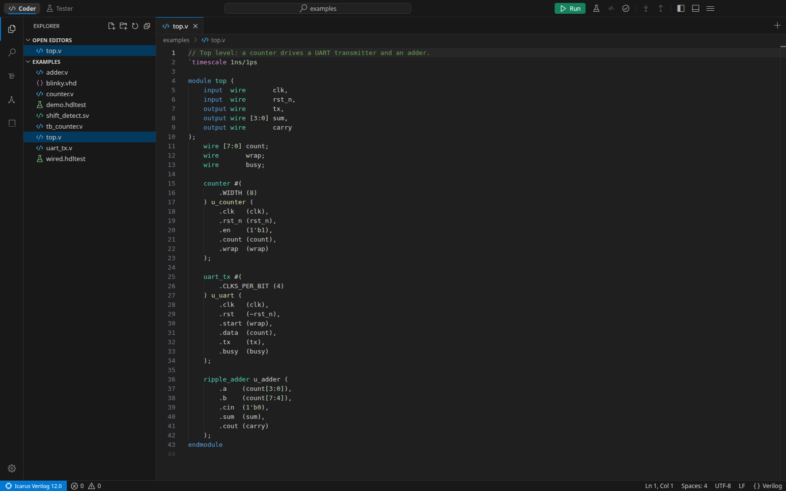
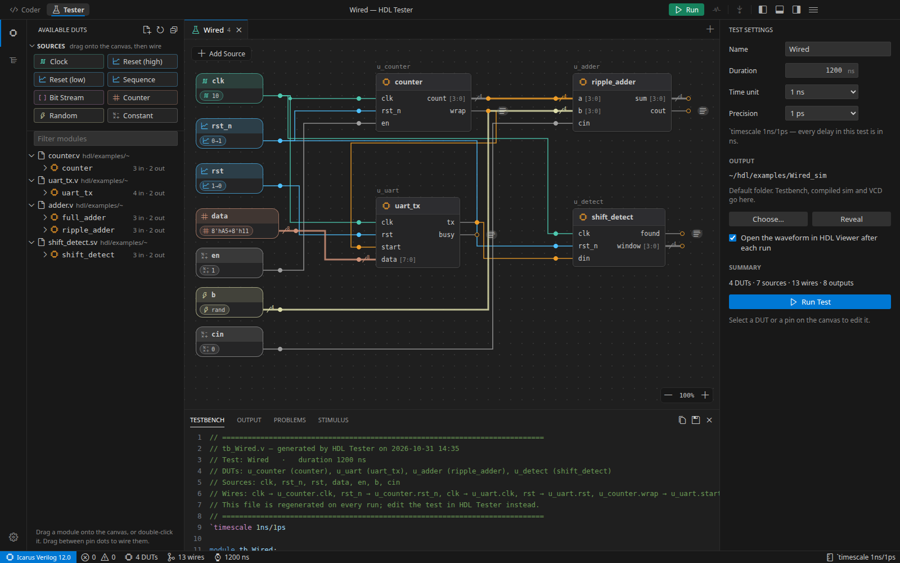
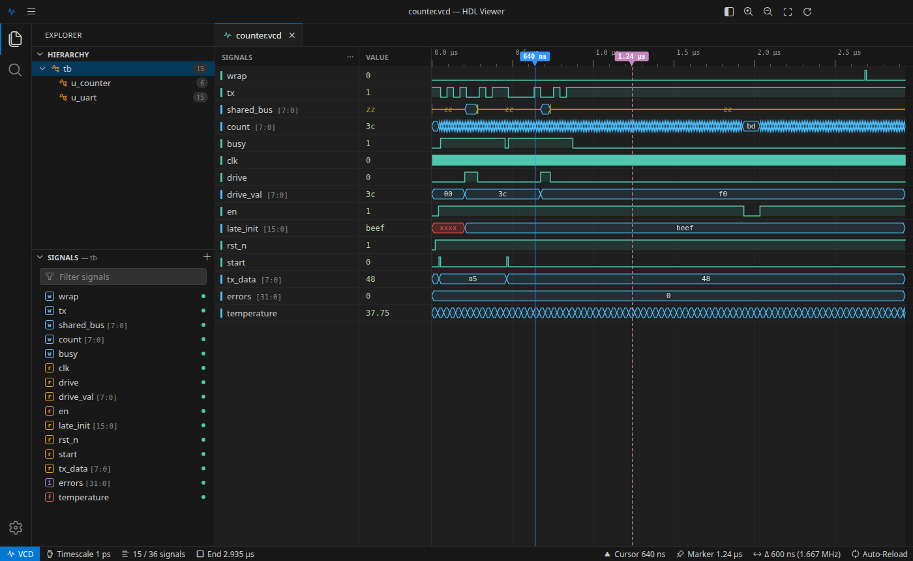
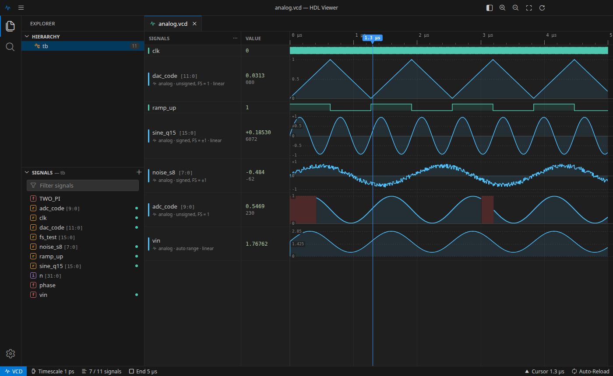

# HDLTool

Two desktop apps for writing, testing and viewing Verilog designs, styled after VS Code. Both run on macOS (native Swift) and Windows (Electron).

| App | What it does |
|---|---|
| **HDL Simulator** | A Verilog/VHDL editor (**Coder**) and a visual testbench builder (**Tester**) in one window, as two tabs. Runs simulations with Icarus Verilog. |
| **HDL Viewer** | A waveform viewer for VCD files, with digital and analog display. Kept as a separate app so it can sit on its own monitor. |

## HDL Simulator

### Coder

Write Verilog, SystemVerilog or VHDL with syntax coloring, automatic `end` / `endmodule`, completions, snippets, go to definition and inline lint errors. Open a folder and the Coder finds modules across files, works out the design hierarchy and the compile order.



### Tester

Build a testbench by drawing it. Drag modules from the left onto the canvas, add sources (clock, reset, sequence, bit stream, counter, random, constant) and wire them to the pins. The Verilog testbench is generated as you go (bottom panel). Press **Run** to simulate, and the waveform opens in HDL Viewer.



From the Coder, the test-tube button (⌥⌘T / Ctrl+Alt+T) turns the module at the caret into a wired-up test in the Tester. **Descend** and **Ascend** move up and down the design hierarchy between the two tabs.

## HDL Viewer

Open a `.vcd` file, pick a scope in the Explorer and add signals. The waveform reloads by itself when the file changes, so re-running the simulation refreshes it. Place a cursor and a marker to measure the time between them (and the matching frequency).



Buses can be drawn as analog traces: unsigned (0 to 1), signed (−1 to +1) or auto range (also for `real` signals), with step or linear interpolation and taller rows. Right-click a signal → **Display**.



## Install

### Windows

Run `HDL Simulator Setup 1.0.0.exe` and `HDL Viewer Setup 1.0.0.exe`. Each installs for the current user (no admin rights needed) and adds Start menu and desktop shortcuts. The installers are not code-signed, so SmartScreen warns the first time: click **More info → Run anyway**.

Running simulations needs [Icarus Verilog for Windows](https://bleyer.org/icarus/) (or the OSS CAD Suite). HDL Simulator looks for it in the usual places, or you can set the folder in **Settings → Tools** (Ctrl+,).

On Windows, shortcuts use Ctrl instead of ⌘, and the menus are behind the ☰ button in the title bar.

### macOS

Needs the Command Line Tools (Swift 6) and Icarus Verilog (`brew install icarus-verilog`).

```bash
cd mac/HDLViewer
./build_app.sh --install      # builds HDL Viewer.app and copies it to ~/Applications
```

```bash
cd mac/HDLSimulator
./build_app.sh --install      # builds HDL Simulator.app and copies it to ~/Applications
```

## Repository layout

| Path | What it is |
|---|---|
| [`mac/HDLSimulator`](mac/HDLSimulator) | macOS HDL Simulator (Swift). Its [README](mac/HDLSimulator/README.md) covers the tabs, testbench generation and descend/ascend. |
| [`mac/HDLViewer`](mac/HDLViewer) | macOS HDL Viewer (Swift). Its [README](mac/HDLViewer/README.md) lists the shortcuts and the analog display options. |
| `*/examples` | Example Verilog, VHDL, `.hdltest` and `.vcd` files to try the apps with. |

## Try it

```bash
cd mac/HDLViewer/examples
iverilog -o sim counter_tb.v && vvp sim    # writes counter.vcd
```

Then open `counter.vcd` in HDL Viewer. In HDL Simulator, **Open Example Project** on the welcome page loads the example designs and tests.
